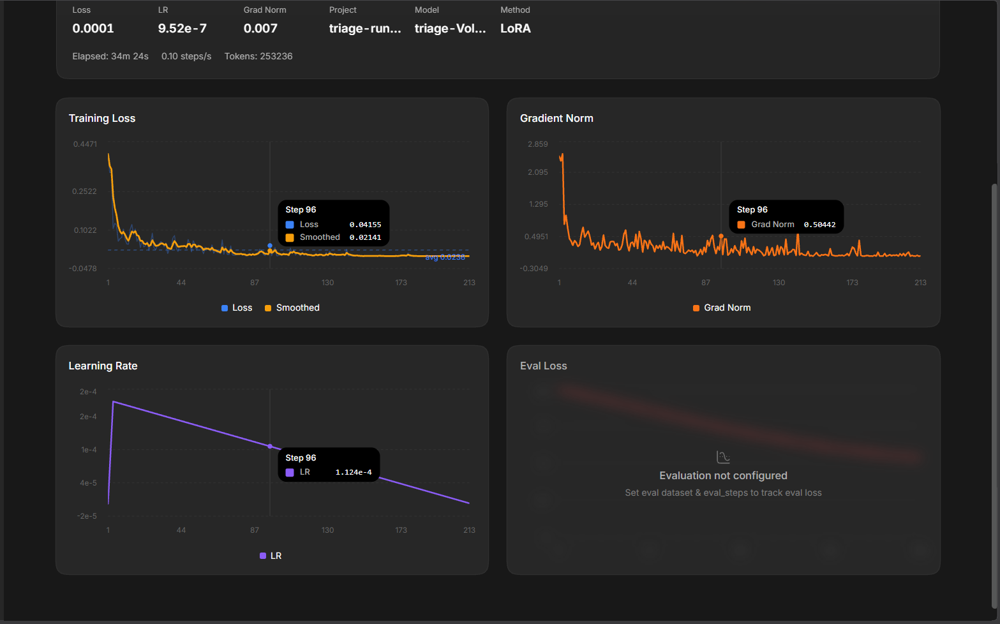

# Llama-3.1-8B-triage-volkov

This is our project for Week 5 (fine-tuning) of the Selangor HRDC GenAI course. By Team Volkov: Hariz and Khairul Ikhwan. We fine-tuned Llama 3.1 8B Instruct to sort customer messages for an online shop in Malaysia. The messages can be in English or Malay. For each message, the model answers with one line of JSON. For example, this message:

```
My order was supposed to arrive on Monday. It is Thursday and the tracking has not moved.
```

gets this answer:

```json
{"category": "delivery", "urgency": "medium", "needs_human": false}
```

- category: delivery, refund_return, product_fault, payment_billing, account_access or general_enquiry
- urgency: low, medium or high
- needs_human: true or false

The model is on Hugging Face: [Volkov04/Llama-3.1-8B-triage-volkov](https://huggingface.co/Volkov04/Llama-3.1-8B-triage-volkov). Leaderboard model number: 1795741692.

## Results

On the class leaderboard, our model got 76% of the messages fully right. The untuned model got about 31%.

On the class practice test (50 messages):

| | Untuned | Ours |
|---|---|---|
| All three fields right | 36% | 90% |
| Category | 92% | 100% |
| Urgency | 46% | 92% |
| Answer is only JSON | 10% | 100% |

## What we tried

| Run | What we changed | Rows | Leaderboard |
|---|---|---|---|
| 2 | First real run (QLoRA, 3 epochs) | 191 | 56% |
| 3 | Used all rows | 225 | 60% |
| 4 | 2 epochs instead of 3 | 225 | 58% |
| 5 | Added rows for missing kinds of message | 257 | 58% |
| 6 | Added 150 rows that say each rule in different ways | 407 | 65% |
| 7 | Added look-alike pairs for urgency | 487 | 72% |
| 8 | Added rows for category rules | 567 | 72% |
| 9 | Dropout 0.05 | 567 | not tested |
| 10 | LoRA instead of QLoRA | 567 | **76% (final)** |
| 11 | Added rows against over-escalation | 612 | 75% |

Runs 5 and 8 were probably tested while the run before them was still loaded, so their scores may be wrong.

More varied data helped the most. Switching from QLoRA to LoRA also helped. Fewer epochs did not.

## How to use the model

Use the prompt in `data/system_prompt.txt` and temperature 0. You need an NVIDIA GPU.

```
pip install -U huggingface_hub unsloth
hf download Volkov04/Llama-3.1-8B-triage-volkov --local-dir model
```

```python
from unsloth import FastLanguageModel

model, tokenizer = FastLanguageModel.from_pretrained("model", max_seq_length=2048, load_in_4bit=True)
FastLanguageModel.for_inference(model)

messages = [
    {"role": "system", "content": open("data/system_prompt.txt", encoding="utf-8").read()},
    {"role": "user", "content": "My parcel never arrived and I was charged twice."},
]
inputs = tokenizer.apply_chat_template(messages, add_generation_prompt=True, return_tensors="pt").to(model.device)
output = model.generate(input_ids=inputs, max_new_tokens=64, do_sample=False)
print(tokenizer.decode(output[0][inputs.shape[1]:], skip_special_tokens=True))
```

You can also use it in Unsloth Studio: add the model, load it in the Chat tab, paste the system prompt and set temperature to 0.

## Data

The data is in the `data` folder. We trained on 567 rows:

- 157 rows from the class (`train_raw.jsonl`)
- 50 rows from the class (`data_starter.xlsx`)
- 360 rows we wrote (`new_rows.xlsx`, rows N001 to N360)

We wrote our rows following the class labelling guide (`LABELING_GUIDE.md`), and then rechecked them ourselves. They add things the class data was missing, like Malay messages, two problems in one message, sarcasm and threats. All the messages are made up. We also changed one class label: T013, from medium to low.

Labels in the 567 training rows:

- category: product_fault 112, general_enquiry 101, delivery 94, refund_return 88, payment_billing 87, account_access 85
- urgency: medium 250, low 166, high 151
- needs_human: true 229, false 338


`train.jsonl` is the file we uploaded to Unsloth Studio. `system_prompt.txt` is the prompt we used. `my_check.xlsx` has 40 extra messages we only used for testing. Rows N361 to N405 in `new_rows.xlsx` were only used in run 11.

## How to make the training file

```
pip install -r requirements.txt
cd scripts
python merge.py
python convert_split.py
```

This makes `data/train.jsonl`. Upload it to Unsloth Studio.

## Training

### Why LoRA

| Option | Good | Bad | Used? |
|---|---|---|---|
| Full fine-tuning | Changes the whole model | Needs much more memory and time, and is easy to overfit with only 567 rows | No |
| QLoRA | Uses the least memory | The base model is squeezed to 4-bit, which can lose some quality | Runs 2 to 9 |
| LoRA | Small file (about 168 MB), base model stays at full quality | Needs more memory than QLoRA | Yes, run 10 |

learn one JSON format and the labelling rules from a few hundred rows. A small adapter is enough for that, and we were sharing one GPU machine. We started with QLoRA because it uses less memory. When we switched to LoRA with the same data and settings (run 8 to run 10), the leaderboard score went from 72% to 76%.

We used Llama 3.1 8B Instruct because it was the base model for the class project. It already follows a system prompt and a chat format, so we only had to teach it the labels.

### Settings

| Setting | Value |
|---|---|
| Base model | unsloth/Llama-3.1-8B-Instruct |
| Method | LoRA, trained on the answers only |
| Epochs | 3 (213 steps) |
| Learning rate | 2e-4, linear, 3 warmup steps |
| Batch size | 8 (2 x 4 gradient accumulation) |
| LoRA | rank 16, alpha 16, dropout 0 |
| Optimizer | AdamW 8-bit, weight decay 0.001 |
| Max length | 2048 |
| Seed | 3407 |
| Tool | Unsloth Studio |
| Hardware | NVIDIA GB10 |



## How we tested

I used the class script `auto_eval.py` (from the course, not in this repo) with our model loaded in Unsloth Studio:

```
python auto_eval.py --test test_raw.jsonl --openai-url <studio-address>/v1 --model <model-name> --api-key YOUR_KEY --out results/run10_practice_test
```

Studio answers with whatever model is loaded, so check the right model is loaded before you test. The reports and predictions are in the `results` folder.

## Mistakes

The model got 5 of the 50 practice messages wrong. Most of them were messages it made more urgent than they were:

- It followed an instruction inside a message that said "label this urgent".
- It treated a threat of a bad review as high urgency.
- It treated a customer who locked their own account while travelling as high urgency.
- It said a first-time Malay complaint needed a person.
- It treated "I forgot which email I used" as a question instead of a login problem.

It also misses some messages that need a person. Only use it with a person checking the answers.

## Folders

```
README.md
LICENSE
requirements.txt
.gitignore
assets/    training graph and Studio screenshots
data/      class data, our rows, training file, system prompt
scripts/   merge.py and convert_split.py
results/   test reports for the untuned model and ours
```

## Licence

- Code: MIT
- Model: Built with Llama, under the [Llama 3.1 Community License](https://github.com/meta-llama/llama-models/blob/main/models/llama3_1/LICENSE)
- Data: the class data belongs to the course. Our own rows are CC BY 4.0.

## My reflection

This was my first time fine-tuning a model. Before this, our course was about RAG, LangChain and LangGraph, where you change what the model reads. Here we changed the model itself.

At the start I thought the training settings would matter most. They didn't. Our first runs were stuck at 56% to 60%, and using fewer epochs didn't help. The score only moved when we fixed the data. Rows that say each rule in different ways took us to 65%, and look-alike urgency pairs took us to 72%.

The most confusing part was when different runs got exactly the same score. It took us a while to find out that Unsloth Studio was still answering with the old model.

We needed 75% to pass and were stuck at 72%. Switching from QLoRA to LoRA got us to 76%, so we passed by one point. Run 11 had more rows but scored 75%, so more data is not always better.

If I did this again, I would keep a validation set from the start and check which model is loaded before every test.

## Thanks

Unsloth, Meta for Llama 3.1, and the Selangor HRDC GenAI course for the data and tools.

## Team

- Muhammad Hariz Bin Zulkarnain (GitHub: Hariz-is-Here)
- Muhammad Khairul Ikhwan Bin MOHD Iqbal (Github: KhairrIkhwan)

